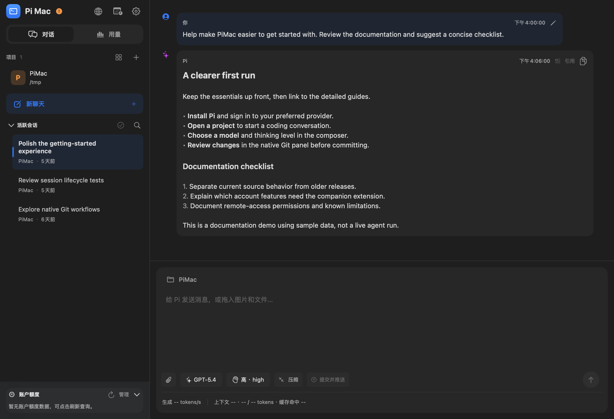

# Pi Mac

[English](README.md) | **简体中文**

[](https://github.com/TianYa-Q/PiMac/actions/workflows/release.yml)
[](https://github.com/TianYa-Q/PiMac/releases/latest)
[](https://github.com/TianYa-Q/PiMac)
[](LICENSE)

使用 SwiftUI 构建的原生 macOS [Pi coding agent](https://github.com/earendil-works/pi) 工作台。在一个窗口里切换项目、跟进代理对话、审阅代码变更，不必一直守着终端。

PiMac 使用官方 [T3 Server](https://github.com/pingdotgg/t3code) orchestrator V2 和内置 Pi Provider。项目、线程、队列与持久化由 Server 管理，PiMac 提供原生界面和 Mac 宿主集成；不为上游 Provider、模型、工具或委派能力额外设置专属白名单。

> 本文描述的是**当前源码**，不代表所有已发布版本都具备相同功能。项目仍在持续迭代；真实历史会话升级与 iOS 实机兼容性仍待验收。详见[架构与已知限制](docs/t3-server-migration.md)。



*截图使用当前 SwiftUI 视图，在隔离窗口中渲染本地演示数据，不含真实会话或账户；Server 有意保持离线。界面目前包含中文标签。*

## 核心功能

- **项目与对话**：切换项目、搜索会话、查看父子任务关系，区分运行中任务与未读完成状态。
- **代理工作流**：流式回答和思考过程、工具调用查看、文件与图片附件、执行中插入指令、后续消息排队、取消任务及上下文压缩。
- **模型与上下文**：选择可用模型和思考等级，配置模型显示与上下文限制，查看可用的 Token／上下文指标；缺失指标不会伪装成实测结果。
- **原生 Git**：查看分支、变更文件与可搜索差异，审阅选定文件后提交、推送、拉取或创建 PR。详见 [Git 工作流](docs/t3-code-integration.md#git--vcs)。
- **账户管理**：独立于对话管理受支持的 ChatGPT／Codex 账户并查询额度。可选配套扩展负责会话凭据与安全轮换，不再负责账户管理界面。详见[账户职责与安装](extensions/account-usage/README.md)。
- **连接与自动化**：管理 Server 定时任务，通过 Telegram 操作对话，或使用兼容的 T3 iOS 客户端经局域网／T3 Connect 接入。
- **Mac 集成**：原生扩展对话框、任务完成通知，以及可选的插电合盖运行。详见[合盖运行配置与安全说明](docs/lid-sleep.md)。

## 快速开始

### 环境要求

- macOS 14 或更高版本。
- 已安装并认证的 Pi；文档兼容性基线为 **1.0.0**，详见 [Pi 兼容性说明](docs/pi-1.0-compatibility.md)。
- Node.js **24+**，供随应用打包的 T3 Server 使用。

### 安装

1. 从 [GitHub Releases](https://github.com/TianYa-Q/PiMac/releases/latest) 下载 `Pi-Mac-vX.Y.Z.zip`。
2. 解压，将 **Pi Mac.app** 移入“应用程序”目录。
3. 按 [Pi 官方说明](https://github.com/earendil-works/pi)安装并完成认证。如果 PiMac 未自动找到 Pi，请在设置中检查可执行文件路径。
4. 打开项目，选择可用模型，发送消息。

> 当前发行版使用 ad-hoc 签名，尚未经过 Apple 公证。如果 macOS 首次启动时拦截，请在 Finder 中右键应用并选择“打开”，或在“系统设置 → 隐私与安全性”查看拦截提示。仅运行你信任的下载。

### 可选：账户会话适配扩展

需要托管会话凭据与安全轮换时，在源码目录安装 `account-usage`：

```sh
npm --prefix extensions/account-usage ci --ignore-scripts
./scripts/link-account-usage.sh
```

避免重复安装旧扩展。现有运行时须在任务结束后安全重新打开／加载扩展。账户私有数据保存在 `~/.pi/agent`（或 `PI_CODING_AGENT_DIR`），不写入仓库。旧 Pi `/usage` 命令与 `/accounts` 管理菜单已移除，Telegram `/usage` 是独立功能。启用轮换或后台激活前请阅读[扩展说明](extensions/account-usage/README.md)：激活会发送真实请求，可能消耗订阅额度。

## 远程使用

### Telegram

通过 Telegram 的 `@BotFather` 创建机器人。在**设置 → Telegram 远程控制**填入 Token 和你的数字用户 ID，启用并保存。在私聊中使用 `/help`、`/projects`、`/sessions`、`/model`、`/status`、`/stop` 等命令，也可以向对话发送文本、图片和文档；部分扩展对话框仍需在 Mac 上处理。

请保持 Mac 唤醒、联网并运行 PiMac。远程控制默认关闭，只接受配置用户的私聊。机器人 Token 和待投递数据以未加密形式存于本机应用偏好；机器人聊天并非端到端加密，远程任务拥有与桌面任务相同的本机执行权限。确认丢失可能导致 Telegram 重复投递，不应将消息通道视为“恰好一次”执行保证。

### T3 iOS／T3 Connect

在**设置 → T3 iOS 连接**查看局域网配对或官方 T3 Connect。两者共用同一 Server 与环境。局域网默认开启，使用未加密 HTTP，仅应在可信网络中使用，不要将端口转发到公网。T3 Connect 使用经认证的 Cloudflare Tunnel，不是端到端加密。手机需支持 protocol 2；已安装的 App Store 版本、Apple 登录和 APNs 仍需实机验证。详见[连接步骤与安全边界](docs/t3-code-integration.md)。

## 当前边界

- 工具展示遵循官方 V2 协议，不恢复任意终端 widget 或旧私有富输出链路；受支持的工具图片及本地 Markdown 图片通过校验后的 Server 资源展示。
- 桌面不是第二套 Pi runtime，也不另行写入会话文件；旧自研 Adapter 的会话升级后，**不保证续接完全相同的原生运行时**。
- 模型支持与权限沿用上游。Provider 发现默认只启用 Pi，这是可修改的发现偏好，不是禁止其他上游 Provider。
- 不以旧截图或历史优化记录推断当前功能。迁移边界请看[架构说明](docs/t3-server-migration.md)，账户行为以[当前账户说明](extensions/account-usage/README.md)为准。

## 本地开发

需要 Swift 5.10+ 和 Node.js 24+：

```sh
git clone https://github.com/TianYa-Q/PiMac.git
cd PiMac
./scripts/prepare-t3-server.sh
python3 scripts/dev.py
```

Watcher 构建独立的开发应用，仅在活动与编辑批次安全门通过后重载。**有任务运行时不要停止或重启 watcher**：停止它也会停止其应用及子服务。多步骤运行时代码修改前执行 `python3 scripts/dev.py --begin-edit --label 'task'`，保留 Token，验证完成后用 `--end-edit TOKEN` 仅关闭自己的批次。详见[开发重载安全机制](docs/development-reload.md)。

验证入口：

```sh
./scripts/lint.sh
swift test --jobs 2 --no-parallel
npm --prefix sidecars/t3-server run check
npm --prefix sidecars/t3-server test
```

测试默认串行运行，Swift 编译最多 2 个任务，Server 测试打包的 esbuild 工作线程也限制为 2。日常优先用 `swift test --jobs 2 --no-parallel --filter SuiteName` 验证受影响套件；不要同时启动多个测试命令。`./scripts/check.sh` 用于需要全量验证时，会重新准备 Server，不必每次小改动都执行。

本地打包使用 `APP_VERSION=0.1.0 BUILD_NUMBER=1 ./scripts/package-app.sh`。推送 `vX.Y.Z` 标签后由 [Release 工作流](.github/workflows/release.yml)发布。Apple 公证需要自行配置 Developer ID。

## 参与贡献

欢迎问题反馈、文档修正与聚焦的 PR。请说明 macOS／Pi 版本、复现步骤，以及使用发行版还是源码构建。分享日志或截图前，移除 Token、配对凭据、私密对话和账户数据。

## 许可证

[MIT](LICENSE)
